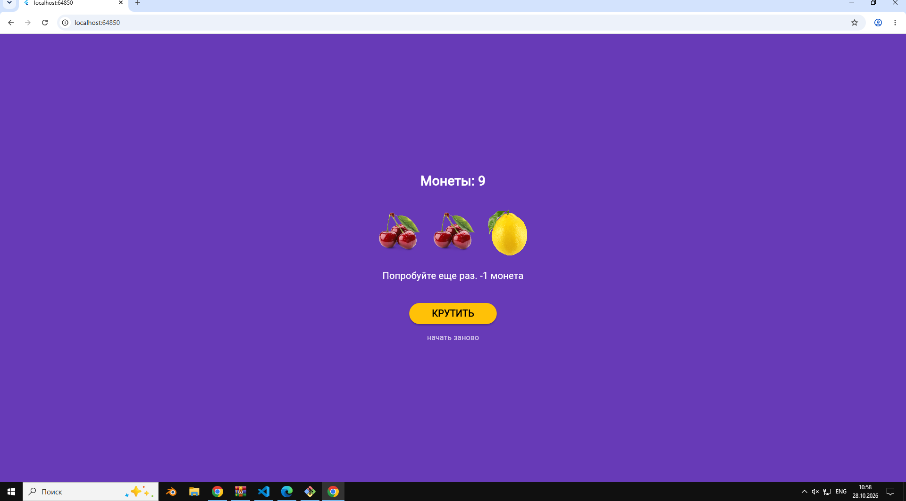
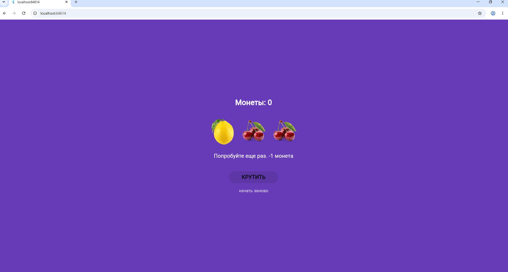

# Лабораторная работа №9 — Flutter: StatefulWidget и управление состоянием

## Авторы работы
* **Студенты:** Игошин Кирилл, Имашев Наиль
* **Группа:** ИСП-242
* **Дата сдачи:** 28.10.2026

---

## Что было изучено в ходе работы
* **изучили разницу между StatelessWidget и StatefulWidget**
* **научились управлять состоянием приложения через setState()**
* **подключать локальные изображения и обрабатывать нажатия кнопок - на примере слот-машины.**

---

### Скриншот рабочего приложения 
 
### Состояние  при 0 монет
 

---
## Как запустить
1. `git clone <url>`
2. `cd slot_machine...`
3. `flutter pub get`
4. `flutter run -d chrome`
