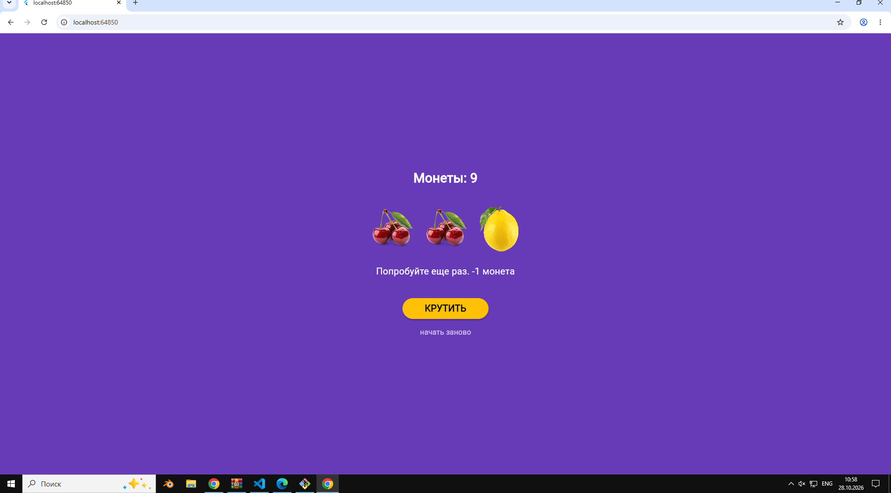

# Лабораторная работа №10. Слот-машина
Авторы: Игошин Кирилл, Лазарев Иван. Группа: ИСП-242. Дата: 02.11.2026.
| Главный экран | Результат | Монеты закончились |
| --- | --- | --- |
|  |  | ![Нет монет]
(img/step4_Igoshin_Imashev.png) |
- Запуск: `flutter pub get`, затем `flutter run -d chrome` или `flutter run -d
ID_устройства`.
- Звук включается отдельной кнопкой; до её нажатия приложение молчит.
- Сборка Android: `flutter build apk --release`.
- Готовый файл: `build/app/outputs/flutter-apk/app-release.apk`.
- APK: ссылка на файл собственного GitHub Release.
- Проверенные Flutter/Dart: фактический вывод `flutter --version`.
- Изучено: состояние и анимация; локальные ресурсы; аудиофокус; жизненный цикл и
освобождение плееров; иконки; Web и Android release-сборки.
